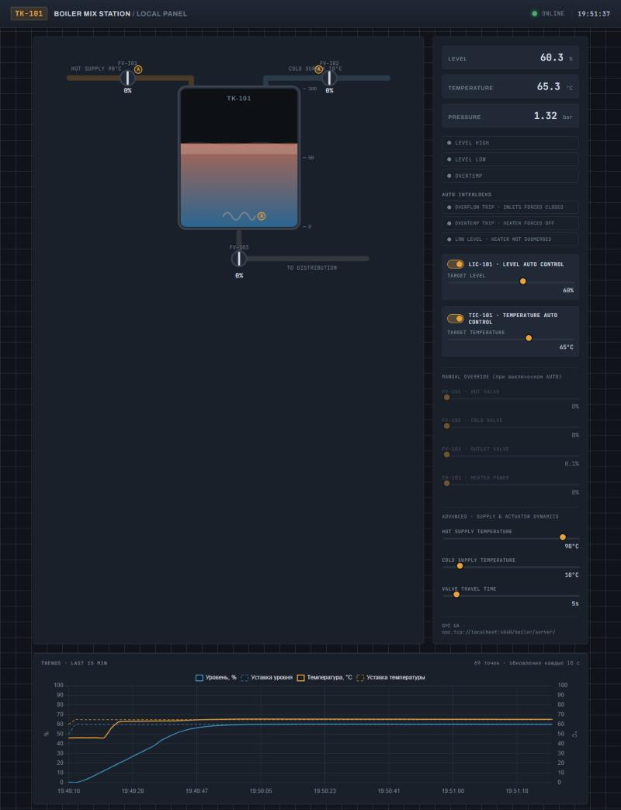
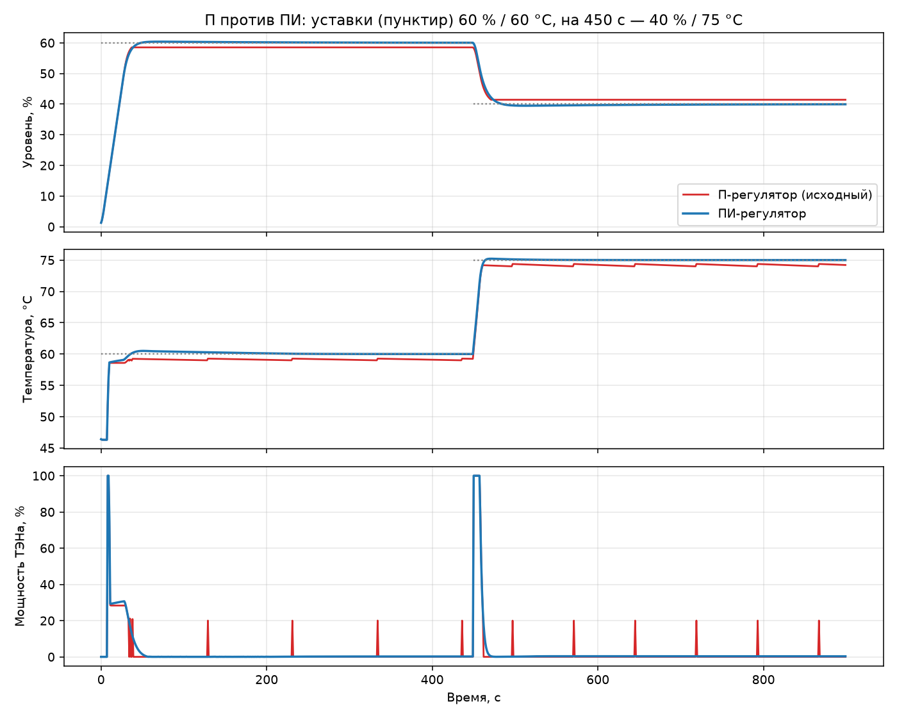

# Boiler SCADA · OPC UA

Симулятор бойлера смешения (горячая + холодная вода → выход) с **OPC UA сервером**, веб-панелью оператора в стиле промышленной SCADA, авторегуляторами уровня и температуры, технологическими блокировками и историей в SQLite.

Проект вырос из производственной практики в **ЛУКОЙЛ-Технологии** (июнь – июль 2026). Задание делала команда из пяти студентов; я вёл общий репозиторий и собрал из решений итоговую систему. Здесь — эта сборка, доработанная после практики: ПИ-регуляторы, защита ТЭНа, тренды, тесты и CI.



## Архитектура

```
                     ┌──────────────────────────────┐
                     │ server_main.py               │
                     │  BoilerModel (шаг 1 с)       │
                     │  + OPC UA сервер :4840       │
                     └──────────────┬───────────────┘
                     opc.tcp        │        opc.tcp
            ┌───────────────────────┴───────────────────────┐
┌───────────▼────────────┐                     ┌────────────▼─────────────┐
│ app.py (Flask :5050)   │                     │ history_logger.py        │
│ мнемосхема, уставки,   │◄──── SQLite ────────│ срез тегов каждые 5 с,   │
│ тренды /api/history    │                     │ очистка старше 24 ч      │
└────────────────────────┘                     └──────────────────────────┘
```

Три независимых процесса общаются только через OPC UA и общую БД — так устроены настоящие АСУ ТП, и каждый компонент можно перезапустить отдельно (панель сама переподключается к серверу).

## ПИ-регуляторы вместо П

В итоговой сборке практики уровнем и температурой управляли П-регуляторы с зоной нечувствительности. У них статическая ошибка: уровень останавливался на 58,5 % вместо 60 %, температура — на 59,1 °C вместо 60 °C, а ТЭН поддерживал её короткими импульсами. ПИ-регулятор с защитой от интегрального насыщения ([`src/pid.py`](src/pid.py)) убирает ошибку и держит температуру ровно.



| Регулятор | Величина | Статическая ошибка | Перерегулирование | Время установления (±1) |
|---|---|---|---|---|
| П (исходный) | уровень | 1,4–1,5 % | 0 | не входит в коридор |
| П (исходный) | температура | 0,8–0,9 °C | 0 | 417–436 с |
| **ПИ** | уровень | **≤ 0,05 %** | 0,4–0,5 % | **26–41 с** |
| **ПИ** | температура | **0 °C** | 0,2–0,5 °C | **11–24 с** |

Коэффициенты подобраны перебором на модели; воспроизвести таблицу и график: `python scripts/compare_controllers.py`. Вернуть исходные регуляторы: переменная окружения `CONTROLLER=p`.

## Найденная ошибка: «сухой» нагрев

При старте в AUTO из пустого бака регулятор температуры сразу включал ТЭН на 1000 кВт, а воды в баке было ~4 кг. За одну секунду температура подскакивала до **108 °C**, и защита от перегрева срабатывала уже после этого. В ручном режиме ТЭН на 100 % в пустом баке «кипятил» воду до 130 °C.

Добавлена блокировка, как на реальных установках: пока ТЭН не покрыт водой (уровень < 10 %, сброс с гистерезисом на 12 %), нагрев запрещён. Тег `Boiler/Interlocks/DryHeat`, индикатор на панели. Теперь максимум при старте — 60 °C, сценарий закрыт регрессионными тестами.

Ещё одно исправление — в панели: диски клапанов на мнемосхеме при любом открытии, кроме 100 %, улетали в сторону. Причина в CSS: для SVG `transform-origin: center` без `transform-box: fill-box` означает центр всей схемы, а не самого диска.

## Что умеет система

- **Модель:** баланс массы и энергии (кДж), давление от заполнения и перегрева, теплопотери через стенки, плавный ход клапанов (время полного хода настраивается).
- **OPC UA:** иерархическое адресное пространство `Measurements / Setpoints / Alarms / Interlocks / Effective`, клиент сам узнаёт индекс пространства имён.
- **Защиты:** переполнение (закрывает притоки), перегрев (отключает ТЭН), сухой нагрев; сигнализации уровня и температуры.
- **Панель:** анимированная мнемосхема, ручное и автоматическое управление, тренды уровня и температуры с уставками за 15 минут.
- **История:** SQLite, отдельный процесс-логгер, автоочистка старых записей, REST `GET /api/history?minutes=N`.

## Запуск

### Docker (весь стек)

```bash
docker compose up --build
```

- Панель: http://localhost:5050
- OPC UA: `opc.tcp://localhost:4840/boiler/server/`
- История: `./data/boiler_history.sqlite3`

С исходными П-регуляторами: `CONTROLLER=p docker compose up --build`.

### Без Docker

```bash
python -m venv .venv
source .venv/bin/activate        # Windows: .venv\Scripts\activate
pip install -r requirements.txt
cd src
python server_main.py            # терминал 1: модель + OPC UA сервер
python history_logger.py         # терминал 2: история в SQLite
python app.py                    # терминал 3: панель на http://localhost:5050
```

### Тесты

```bash
pip install -r requirements-dev.txt
pytest -q
```

27 тестов: физика модели, блокировки, ход клапанов, ПИД, а также интеграционный тест с настоящим OPC UA сервером и клиентом. CI на GitHub Actions прогоняет линтер, тесты, сравнение регуляторов и собирает Docker-образ с пробным подключением клиента к серверу.

## Адресное пространство OPC UA

| Узел | Тип | Доступ | Описание |
|---|---|---|---|
| `Measurements/Level`, `Temperature`, `Pressure` | Double | RO | уровень, %; температура, °C; давление, бар |
| `Measurements/TemperatureValid` | Boolean | RO | `False`, если бак пуст и мерить нечего |
| `Setpoints/HotValve`, `ColdValve`, `OutletValve`, `Heater` | Double | RW | уставки клапанов и ТЭНа, % |
| `Setpoints/LevelSetpoint`, `TemperatureSetpoint` | Double | RW | уставки авторегуляторов |
| `Setpoints/LevelAuto`, `TemperatureAuto` | Boolean | RW | включение авторегуляторов |
| `Setpoints/ValveTravelTime`, `InputTempHot`, `InputTempCold` | Double | RW | время хода клапана, с; температуры магистралей, °C |
| `Alarms/LevelHigh`, `LevelLow`, `OverTemperature` | Boolean | RO | сигнализации |
| `Interlocks/Overflow`, `Overtemp`, `DryHeat` | Boolean | RO | сработавшие блокировки |
| `Effective/HotValve`, `ColdValve`, `Heater` | Double | RO | фактическое положение после хода клапана и блокировок |

Все узлы лежат под `Objects/Boiler`. Начальные условия по заданию: бак пуст, клапаны 50 / 50 / 100 %, магистрали 90 °C и 10 °C, шаг модели 1 с.

## Команда и авторство

| Участник | Вклад |
|---|---|
| **Сергей Якимов** ([@fandaray](https://github.com/fandaray)) | Организация репозитория практики: шаблон проекта, CI, CODEOWNERS, ревью и слияние пулл-реквестов; сборка итоговой системы из решений команды; после практики — ПИ-регуляторы, блокировка сухого нагрева, тренды и `/api/history`, тесты, CI, Docker Compose для всего стека |
| Рикхельгоф ([@Surevio](https://github.com/Surevio)) | Основа сборки: физическая модель на энергобалансе, авторегуляторы и блокировки, адресное пространство OPC UA, веб-панель с мнемосхемой |
| Хабаров ([@artemka1175](https://github.com/artemka1175)) | Динамика хода клапанов, режим ТАУ с ПИД-регулированием |
| Голубева ([@Polina415](https://github.com/Polina415)) | ПИД-регулятор с anti-windup (взят за основу `pid.py`), конфигурация через `.env`, валидация уставок, очистка истории |
| Мамаев ([@han-128](https://github.com/han-128)) | Визуализация и графики, разбор безопасного поведения клапанов при аварии |

Исходный учебный репозиторий со всеми решениями: [fandaray/practice_project](https://github.com/fandaray/practice_project).

## Ограничения

- Endpoint OPC UA открыт без шифрования и аутентификации — осознанное упрощение для учебного стенда.
- Используется библиотека `opcua` (python-opcua), которая больше не развивается; следующий шаг — переход на `asyncua`.
